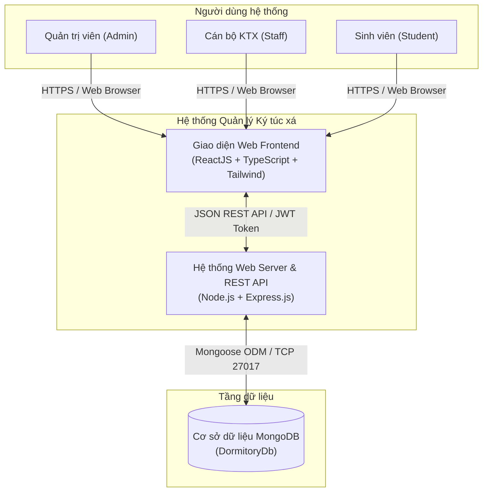
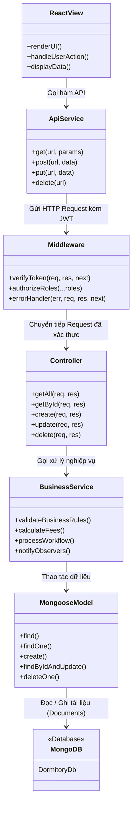

# ARCHITECTURE DESIGN
## Website Quản lý Ký túc xá (QLKTX)

---

### LỊCH SỬ CHỈNH SỬA

| Phiên bản | Ngày | Người thực hiện | Ghi chú |
|:---:|:---:|---|---|
| 1.0 | 21/09/2026 | Nhóm 06 | Khởi tạo tài liệu kiến trúc sơ bộ |
| 1.1 | 26/10/2026 | Đỗ Thành Đức, Dương Minh Hùng, Tống Nhật Phát | Cập nhật phân rã C&C, góc nhìn vật lý, động và tĩnh cho toàn bộ phân hệ QLKTX |

---

## I. Giới thiệu

Tài liệu này mô tả chi tiết kiến trúc phần mềm cho **Hệ thống Quản lý Ký túc xá (QLKTX)**. Hệ thống được xây dựng nhằm tự động hóa công tác quản lý phòng ở, xét duyệt hồ sơ đăng ký, quản lý hợp đồng, tính toán chỉ số điện nước, phát hành hóa đơn và xử lý yêu cầu sửa chữa cơ sở vật chất.

Người đọc nên tham khảo tài liệu **Architecture Driver** và **Function List** trước khi đọc tài liệu này để nắm rõ các yêu cầu chức năng (FR) và thuộc tính chất lượng (Quality Attributes) của hệ thống.

---

## II. Tài liệu kiến trúc

### 1. Sơ đồ ngữ cảnh (Context Diagram)

Hệ thống Quản lý Ký túc xá tương tác với **3 nhóm Actor chính**:
* **Sinh viên (Student):** Truy cập hệ thống để tra cứu phòng ở, gửi đơn đăng ký lưu trú, xem và thanh toán hóa đơn điện nước/tiền phòng, gửi yêu cầu sửa chữa thiết bị, theo dõi kỷ luật và nhận thông báo.
* **Cán bộ KTX (Staff):** Quản lý hồ sơ sinh viên, tiếp nhận và duyệt đơn đăng ký, xếp phòng/giường, lập hợp đồng lưu trú, ghi chỉ số điện nước định kỳ, duyệt hóa đơn và điều phối sửa chữa.
* **Quản trị viên (Admin):** Toàn quyền cấu hình hệ thống, quản lý danh mục tòa nhà, phòng, giường, đơn giá dịch vụ, phân quyền tài khoản người dùng và xem báo cáo tài chính cấp cao.

Tất cả các Actor truy cập thông qua trình duyệt web (máy tính hoặc điện thoại thông minh) tới **Website Quản lý Ký túc xá (React Frontend + Node.js/Express Backend REST API)**. Hệ thống lưu trữ và truy xuất toàn bộ dữ liệu tập trung trong cơ sở dữ liệu **MongoDB (`DormitoryDb`)**.

---

### 2. Phân rã Component-and-Connector (C&C)

#### 2.1 Góc nhìn vật lý (Physical Perspective)

| Thành phần | Trách nhiệm |
|---|---|
| **Client** | Trình duyệt web của người dùng (máy tính để bàn, laptop hoặc điện thoại thông minh) chạy ứng dụng Single Page Application (SPA) xây dựng bằng ReactJS, chịu trách nhiệm render giao diện và tiếp nhận tương tác của người dùng. |
| **Internet / Local Network** | Hạ tầng mạng kết nối các máy trạm của Client tới máy chủ hệ thống thông qua giao thức HTTP/HTTPS an toàn. |
| **Reverse Proxy (Nginx / Vite Dev Proxy)** | Tiếp nhận các request từ phía Client, cân bằng tải, phục vụ các tệp tĩnh (static assets: HTML, CSS, JS, hình ảnh), chuyển tiếp các yêu cầu có tiền tố `/api` tới Web Server Backend và hỗ trợ cấu hình CORS/SSL. |
| **Web Server (Node.js / Express)** | Xử lý toàn bộ logic nghiệp vụ của hệ thống, xác thực danh tính người dùng (JWT Authentication), phân quyền vai trò (RBAC), kiểm tra tính hợp lệ của dữ liệu đầu vào và cung cấp các endpoint REST API trả về dữ liệu dạng JSON. |
| **Database Server (MongoDB)** | Máy chủ cơ sở dữ liệu NoSQL lưu trữ toàn bộ dữ liệu có cấu trúc của hệ thống (tài khoản, sinh viên, tòa nhà, phòng, giường, đơn đăng ký, hợp đồng, chỉ số điện nước, hóa đơn, thanh toán, sửa chữa, vi phạm). Đảm bảo tính toàn vẹn dữ liệu, hỗ trợ Index tối ưu tốc độ truy vấn. |

---

#### 2.2 Góc nhìn động (Dynamic Perspective) — Luồng Đăng ký lưu trú KTX (Sinh viên)

| Thành phần | Trách nhiệm |
|---|---|
| **React View (Trang đăng ký phòng)** | Hiển thị biểu mẫu đăng ký (`StudentRegisterPage.tsx`), cho phép sinh viên chọn tòa nhà mong muốn, loại phòng, thời hạn thuê (tháng), ngày bắt đầu ở và nhập nguyện vọng. Kiểm tra hợp lệ form trước khi gửi request. |
| **Registration Controller (Express Router)** | Tiếp nhận yêu cầu `POST /api/registrations`, trích xuất thông tin người dùng từ JWT Token (`req.user.studentId`), kiểm tra dữ liệu gửi lên và chuyển tiếp tới Service xử lý nghiệp vụ. |
| **Registration Service** | Kiểm tra ràng buộc nghiệp vụ (sinh viên đã có đơn đăng ký chờ duyệt hoặc hợp đồng đang hiệu lực hay chưa). Nếu hợp lệ, tự động sinh mã đăng ký (`REG-YYYYMM-XXX`) và tạo bản ghi đăng ký mới với trạng thái `1: Pending`. |
| **Registration Model (Mongoose Schema)** | Định nghĩa cấu trúc lược đồ dữ liệu đơn đăng ký (`Registration.js`), thực thi lưu trữ bản ghi vào collection `registrations` trong MongoDB và kích hoạt thông báo tới Cán bộ KTX. |

---

#### 2.3 Góc nhìn động (Dynamic Perspective) — Luồng Tiếp nhận & Xếp phòng (Cán bộ KTX)

| Thành phần | Trách nhiệm |
|---|---|
| **React View (Trang quản lý đơn đăng ký)** | Cán bộ KTX xem danh sách các đơn đăng ký đang chờ duyệt (`RegistrationsPage.tsx`), xem chi tiết hồ sơ sinh viên, bấm nút duyệt và mở popup chọn phòng/giường trống phù hợp với giới tính. |
| **Registration Controller (Express Router)** | Tiếp nhận request `PUT /api/registrations/:id/approve` kèm thông tin `approvedRoomId` và `approvedBedId`. |
| **Allocation & Contract Service** | Kiểm tra trạng thái giường được chọn có thực sự còn trống (`Bed.status === 1: Available`) và giới tính phòng có khớp với sinh viên không. Tiến hành: (1) Cập nhật trạng thái đơn thành `Approved`; (2) Tự động sinh Hợp đồng lưu trú mới (`Contract`) với trạng thái `Active`; (3) Cập nhật trạng thái giường thành `Occupied`; (4) Cập nhật `Student.isStaying = true`. |
| **Bed & Contract Models (Mongoose Schemas)** | Thao tác ghi dữ liệu đồng thời vào các collections `registrations`, `contracts`, `beds` và `students` trong MongoDB để đảm bảo tính nhất quán dữ liệu. |

---

#### 2.4 Góc nhìn động (Dynamic Perspective) — Luồng Chốt điện nước & Tự động phát hành Hóa đơn

| Thành phần | Trách nhiệm |
|---|---|
| **React View (Trang chỉ số điện nước)** | Cán bộ KTX chọn tòa nhà, chọn phòng, nhập chỉ số điện mới và chỉ số nước mới của tháng hiện tại (`MeterReadingsPage.tsx`). Giao diện tự động tính nhẩm mức tiêu thụ và hiển thị cảnh báo nếu chỉ số mới nhỏ hơn chỉ số cũ. |
| **MeterReading Controller (Express Router)** | Tiếp nhận request `POST /api/meter-readings`, kiểm tra quyền hạn cán bộ và gọi Service xử lý. |
| **Invoicing Service & Factory** | (1) Kiểm tra ràng buộc: `electricityNew >= electricityOld` và `waterNew >= waterOld`; (2) Tính toán lượng điện nước tiêu thụ trong tháng; (3) Áp dụng **Factory Method** tính thành tiền điện (`tiêu thụ * đơn giá điện`) và tiền nước (`tiêu thụ * đơn giá nước`); (4) Lấy thông tin giá phòng từ Hợp đồng đang hiệu lực; (5) Tự động tổng hợp và tạo hóa đơn mới (`Invoice`) cho phòng với trạng thái `1: Unpaid`. |
| **MeterReading & Invoice Models (Mongoose)** | Lưu trữ chỉ số mới vào collection `meterreadings` và lưu hóa đơn tổng hợp vào collection `invoices` trong MongoDB; đồng thời kích hoạt Observer gửi thông báo nộp tiền tới tài khoản các sinh viên trong phòng. |

---

#### 2.5 Góc nhìn động (Dynamic Perspective) — Luồng Báo hỏng & Xử lý sửa chữa cơ sở vật chất

| Thành phần | Trách nhiệm |
|---|---|
| **React View (Trang gửi yêu cầu sửa chữa)** | Sinh viên điền thông tin sự cố hỏng hóc thiết bị trong phòng (`StudentRepairsPage.tsx`), chọn mức độ khẩn cấp (Thấp, Trung bình, Cao, Khẩn cấp), đính kèm mô tả và gửi yêu cầu. |
| **Repair Controller (Express Router)** | Tiếp nhận `POST /api/repairs` từ sinh viên, kiểm tra mã phòng và định tuyến tới Repair Service. |
| **Repair Service (State Pattern)** | Khởi tạo yêu cầu với trạng thái `1: Pending`. Cán bộ KTX sau khi tiếp nhận sẽ chuyển trạng thái sang `2: Processing` (Đang sửa) và gán chi phí sửa chữa. Khi hoàn tất, chuyển sang trạng thái `3: Completed` và ghi nhận thời điểm hoàn thành. |
| **RepairRequest Model (Mongoose Schema)** | Cập nhật và lưu trữ lịch sử xử lý sự cố thiết bị vào collection `repairrequests` trong cơ sở dữ liệu MongoDB. |

---

### 3. Góc nhìn tĩnh (Static Perspective)

Hệ thống được tổ chức theo kiến trúc phân lớp chuẩn **Layered MVC / Clean Architecture**, phân định rõ ràng trách nhiệm của từng thành phần để đảm bảo tính module hóa, dễ kiểm thử và mở rộng:

| Thành phần | Trách nhiệm |
|---|---|
| **React View (Presentation Layer)** | Bao gồm các React Components, Pages, UI Modals và Data Tables. Sử dụng Tailwind CSS để dựng giao diện người dùng theo chuẩn Figma, tương tác trực tiếp với người dùng và nhận dữ liệu từ Controller thông qua Axios API Service. |
| **API Client Service (Facade / Adapter Layer)** | Module đóng gói các hàm gọi HTTP Axios (`frontend/src/api/index.ts`). Che giấu chi tiết cấu hình mạng, tự động đính kèm JWT Bearer Token vào Request Header và chuẩn hóa dữ liệu trả về cho Presentation Layer. |
| **Controller (Express Router Layer)** | Đóng vai trò tiếp nhận các HTTP Request (GET, POST, PUT, DELETE), xác thực quyền truy cập qua Middleware, trích xuất tham số (`params`, `query`, `body`), điều phối gọi tầng Service xử lý và trả về HTTP Response chuẩn (Status Code, JSON Payload, Message). |
| **Middleware Layer** | Các hàm trung gian thực thi trước khi request tới Controller: `verifyToken` (giải mã và kiểm tra hạn JWT), `authorizeRoles` (phân quyền RBAC theo vai trò: Admin, Staff, Student), `errorHandler` (bắt và chuẩn hóa toàn bộ lỗi hệ thống tập trung). |
| **Service Layer (Business Logic Layer)** | Nơi chứa toàn bộ các quy tắc nghiệp vụ cốt lõi của KTX (áp dụng các Design Pattern: Singleton kết nối DB, Factory tạo hóa đơn, Strategy tính giá điện nước, State chuyển đổi vòng đời hợp đồng/sửa chữa, Observer bắn thông báo). Không phụ thuộc vào tầng giao diện. |
| **Model (Mongoose Data Access Layer)** | Định nghĩa cấu trúc Schema, kiểu dữ liệu, các ràng buộc dữ liệu (Unique, Required, Default) và các hàm thao tác trực tiếp với cơ sở dữ liệu MongoDB (CRUD, Aggregation Pipeline). |
| **MongoDB Database Server** | Nơi lưu trữ vật lý toàn bộ 14 collections dữ liệu của Hệ thống Quản lý Ký túc xá (`DormitoryDb`). Đảm bảo độ bền vững, tính sẵn sàng cao và an toàn dữ liệu. |

---

*(Tài liệu thiết kế kiến trúc phần mềm Hệ thống Quản lý Ký túc xá - Nhóm 06)*

