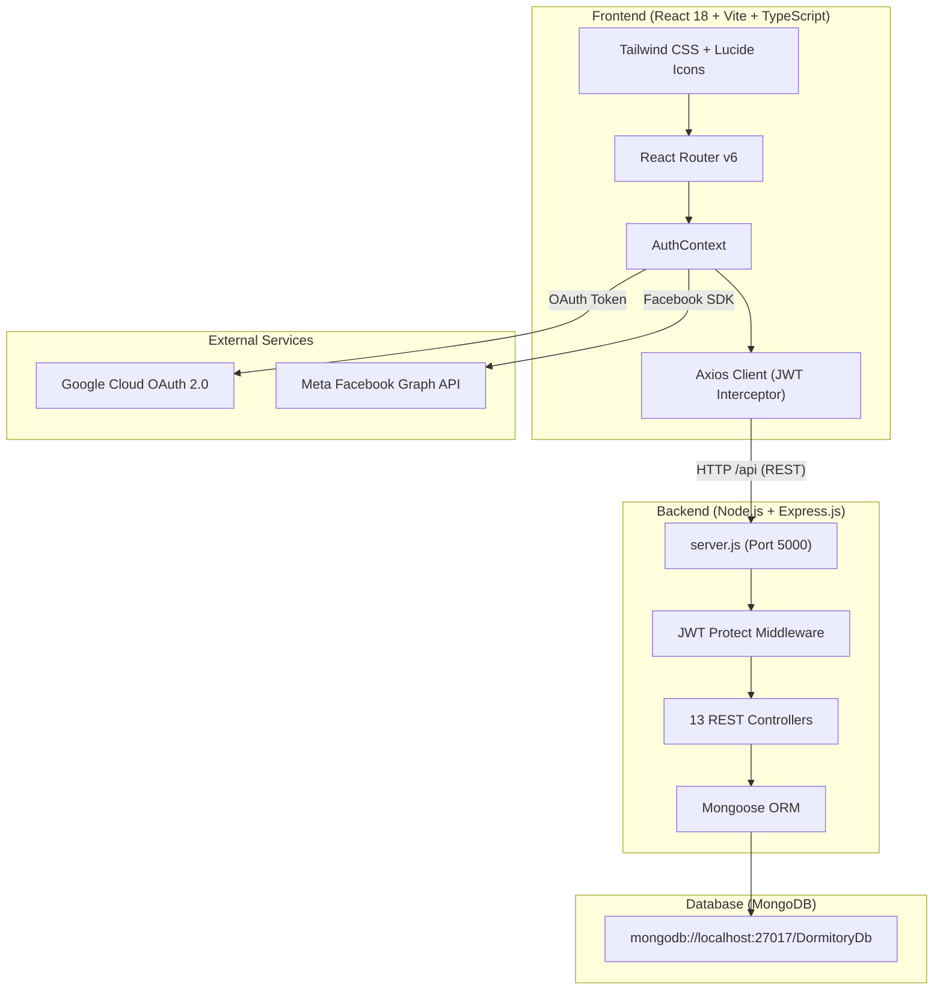

# TÀI LIỆU TỔNG QUAN DỰ ÁN HỆ THỐNG QUẢN LÝ KÝ TÚC XÁ (QLKTX)
> **Phiên bản:** 2.0 (MERN Stack Edition)  
> **Cập nhật lần cuối:** 2026-09-22  
> **Ngăn xếp công nghệ:** MongoDB + Express.js + React 18 + Node.js (MERN)  

---

## MỤC LỤC
1. [Giới thiệu tổng quan](#1-giới-thiệu-tổng-quan)
2. [Kiến trúc hệ thống](#2-kiến-trúc-hệ-thống)
3. [Phân quyền & Đối tượng người dùng](#3-phân-quyền--đối-tượng-người-dùng)
4. [Sơ đồ luồng nghiệp vụ & Tính năng chi tiết](#4-sơ-đồ-luồng-nghiệp-vụ--tính-năng-chi-tiết)
5. [Cơ sở dữ liệu (MongoDB Data Models)](#5-cơ-sở-dữ-liệu-mongodb-data-models)
6. [Danh mục API Endpoints (Backend REST API)](#6-danh-mục-api-endpoints-backend-rest-api)
7. [Cấu trúc thư mục dự án](#7-cấu-trúc-thư-mục-dự-án)
8. [Hướng dẫn cài đặt & Khởi chạy hệ thống](#8-hướng-dẫn-cài-đặt--khởi-chạy-hệ-thống)
9. [Cấu hình OAuth Google & Facebook](#9-cấu-hình-oauth-google--facebook)
10. [Tài khoản dùng thử (Demo Accounts)](#10-tài-khoản-dùng-thử-demo-accounts)

---

## 1. GIỚI THIỆU TỔNG QUAN

**Hệ thống Quản lý Ký túc xá (QLKTX)** là giải pháp phần mềm toàn diện nhằm tự động hóa quy trình quản lý cơ sở lưu trú của các trường Đại học / Cao đẳng:
- **Tối ưu hóa công tác quản lý của Ban Quản Trị (BQL)**: Quản lý tòa nhà, phòng ở, giường ngủ, hợp đồng thuê, tiếp nhận & duyệt đơn đăng ký, ghi chỉ số điện nước, phát hành hóa đơn tự động và ghi nhận thanh toán.
- **Nâng cao trải nghiệm của Sinh viên**: Cho phép sinh viên đăng ký nội trú trực tuyến, theo dõi trạng thái phòng ở, hợp đồng, tra cứu và đóng tiền hóa đơn điện nước, gửi yêu cầu báo hỏng thiết bị và theo dõi kỷ luật/nội quy.

---

## 2. KIẾN TRÚC HỆ THỐNG

Dự án được xây dựng theo mô hình **Client - Server (Decoupled Single Page Application)**:



### Công nghệ cốt lõi:
- **Frontend**:
  - `React 18`, `TypeScript`, `Vite` (Build tool siêu tốc)
  - `Tailwind CSS` (Styling hiện đại, Responsive đa màn hình)
  - `Lucide React` (Icon system)
  - `@react-oauth/google` (Tích hợp Google Login chính thức)
  - Facebook JavaScript SDK (Tích hợp Facebook Login chính thức)
- **Backend**:
  - `Node.js` + `Express.js` (ES Modules)
  - `Mongoose` (Data modeling & Validation)
  - `Bcrypt.js` (Mã hóa mật khẩu an toàn)
  - `JSON Web Token (JWT)` (Xác thực người dùng không trạng thái)
- **Database**:
  - `MongoDB` (Cơ sở dữ liệu NoSQL hiệu năng cao)

---

## 3. PHÂN QUYỀN & ĐỐI TƯỢNG NGƯỜI DÙNG

Hệ thống được chia thành **3 vai trò (Role-Based Access Control - RBAC)**:

| Vai trò | Role ID | Quyền hạn & Chức năng chính |
| :--- | :---: | :--- |
| **Admin (Quản trị viên)** | `1` | Toàn quyền kiểm soát hệ thống: Quản lý tòa nhà, phòng, sinh viên, hợp đồng, phê duyệt đơn, hóa đơn, báo cáo doanh thu, cài đặt tài khoản. |
| **Staff (Nhân viên KTX)** | `2` | Thực hiện nghiệp vụ hàng ngày: Ghi chỉ số điện nước, lập phiếu thu thanh toán, xử lý sửa chữa thiết bị, lập biên bản vi phạm nội quy. |
| **Student (Sinh viên)** | `3` | Đăng ký nội trú trực tuyến, xem thông tin phòng/giường, hợp đồng của tôi, tra cứu hóa đơn cá nhân, báo hỏng thiết bị, xem thông báo. |

---

## 4. SƠ ĐỒ LUỒNG NGHIỆP VỤ & TÍNH NĂNG CHI TIẾT

### 4.1. Luồng Xác thực & Đăng nhập (Authentication)
1. **Đăng nhập truyền thống**: Hỗ trợ đăng nhập linh hoạt bằng **Username** hoặc **Mã sinh viên (MSSV)** (ví dụ: `SV2026001`) kèm mật khẩu.
2. **Đăng nhập Google / Facebook**: Bật Popup OAuth thật; nếu sinh viên mới đăng nhập lần đầu, hệ thống sẽ **tự động khởi tạo hồ sơ sinh viên** tương ứng.
3. **Quên mật khẩu / Tự đặt lại mật khẩu**: Xác thực kết hợp `Username/MSSV` + `Email đăng ký` để cấp lại mật khẩu mới trực tiếp.

### 4.2. Quản lý Cơ sở vật chất (Buildings, Rooms & Beds)
- **Tòa nhà**: Quản lý tên tòa (Ví dụ: Tòa A1 - Nam, Tòa B2 - Nữ), tổng số tầng, số phòng.
- **Phòng ở**: Quản lý mã phòng, loại phòng (4 giường, 6 giường, 8 giường), giá thuê/tháng, trạng thái (còn chỗ / đầy / đang bảo trì), danh sách sinh viên hiện tại.
- **Giường ngủ**: Quản lý trạng thái từng giường (Trống, Đang ở, Đã đặt, Hỏng).

### 4.3. Đăng ký nội trú & Hợp đồng (Registrations & Contracts)
- Sinh viên chọn Tòa $\rightarrow$ Chọn Phòng $\rightarrow$ Chọn Giường $\rightarrow$ Nộp đơn trực tuyến.
- Admin duyệt đơn $\rightarrow$ Hệ thống tự động chuyển trạng thái giường sang "Đã ở" và sinh ra **Hợp đồng thuê phòng** chính thức.
- Gia hạn hoặc chấm dứt hợp đồng khi sinh viên ra trường hoặc trả phòng.

### 4.4. Điện nước & Hóa đơn tự động (Invoices & Meter Readings)
- Nhân viên chốt số điện nước đầu kỳ & cuối kỳ cho từng phòng.
- **Tạo hóa đơn tự động theo tháng (Batch Generate)**: Tự động chia đều tiền điện nước của phòng theo số lượng sinh viên thực tế đang ở + tiền phòng + tiền dịch vụ.
- Sinh viên nhận thông báo hóa đơn tức thời và theo dõi công nợ.

### 4.5. Thanh toán (Payments)
- Quản lý lịch sử thanh toán (Tiền mặt, Chuyển khoản ngân hàng, VNPay, MoMo).
- Cập nhật số tiền đã thanh toán và tự tính `remainingAmount` (Số tiền còn lại).

### 4.6. Báo hỏng thiết bị & Kỷ luật vi phạm (Repairs & Violations)
- Sinh viên gửi yêu cầu sửa chữa (kèm mô tả & mức độ khẩn cấp). Nhân viên tiếp nhận, giao việc và cập nhật trạng thái hoàn thành.
- Ghi nhận các biên bản vi phạm nội quy (về muộn, gây ồn ào, nấu ăn trái phép), mức tiền phạt và gửi thông báo nhắc nhở đến tài khoản sinh viên.

---

## 5. CƠ SỞ DỮ LIỆU (MONGODB DATA MODELS)

Hệ thống sử dụng các Collection được định nghĩa chuẩn hóa trong thư mục `backend/models/`:

1. **`User`**: `id`, `username`, `email`, `fullName`, `passwordHash`, `phone`, `avatarUrl`, `role` (1: Admin, 2: Staff, 3: Student), `isActive`, `refreshToken`.
2. **`Student`**: `id`, `userId`, `studentCode`, `fullName`, `dateOfBirth`, `gender`, `phone`, `email`, `address`, `faculty`, `className`, `citizenId`, `isStaying`.
3. **`Building`**: `id`, `name`, `code`, `genderType`, `totalFloors`, `totalRooms`, `description`, `isActive`.
4. **`Room`**: `id`, `buildingId`, `roomNumber`, `floor`, `roomType`, `capacity`, `occupiedBeds`, `basePrice`, `status`, `genderType`.
5. **`Bed`**: `id`, `roomId`, `bedNumber`, `status` (1: Available, 2: Occupied, 3: Reserved, 4: Maintenance), `notes`.
6. **`Registration`**: `id`, `studentId`, `roomId`, `bedId`, `registrationDate`, `startDate`, `endDate`, `status` (1: Pending, 2: Approved, 3: Rejected, 4: Cancelled).
7. **`Contract`**: `id`, `contractCode`, `studentId`, `roomId`, `bedId`, `startDate`, `endDate`, `monthlyRent`, `depositAmount`, `status`.
8. **`MeterReading`**: `id`, `roomId`, `month`, `year`, `electricityOld`, `electricityNew`, `waterOld`, `waterNew`, `recordedDate`.
9. **`Invoice`**: `id`, `invoiceCode`, `studentId`, `contractId`, `month`, `year`, `roomFee`, `electricityFee`, `waterFee`, `serviceFee`, `totalAmount`, `paidAmount`, `dueDate`, `status`.
10. **`Payment`**: `id`, `paymentCode`, `invoiceId`, `amount`, `paymentMethod`, `paymentDate`, `transactionReference`, `note`.
11. **`RepairRequest`**: `id`, `requestCode`, `studentId`, `roomId`, `title`, `description`, `priority`, `status`, `requestDate`, `completedDate`.
12. **`Violation`**: `id`, `violationCode`, `studentId`, `title`, `description`, `fineAmount`, `violationDate`, `status`, `resolutionNotes`.
13. **`Notification`**: `id`, `userId`, `title`, `content`, `type`, `isRead`, `createdAt`.
14. **`Counter`**: Hỗ trợ tăng tự động mã định danh nguyên thủy (`id` auto-increment) đảm bảo tính tương thích.

---

## 6. DANH MỤC API ENDPOINTS (BACKEND REST API)

Tất cả các API đều có tiền tố `/api` và hỗ trợ UTF-8 JSON.

### 6.1. Xác thực (`/api/auth`)
- `POST /api/auth/login`: Đăng nhập bằng Username / MSSV + Mật khẩu.
- `POST /api/auth/social-login`: Đăng nhập bằng Google / Facebook Token.
- `POST /api/auth/register`: Đăng ký tài khoản sinh viên mới.
- `POST /api/auth/reset-password`: Đặt lại mật khẩu (quên mật khẩu).
- `GET /api/auth/me`: Lấy thông tin tài khoản hiện tại (JWT Required).
- `POST /api/auth/change-password`: Đổi mật khẩu.
- `PUT /api/auth/profile`: Cập nhật thông tin cá nhân.

### 6.2. Sinh viên (`/api/students`)
- `GET /api/students`: Danh sách sinh viên (phân trang & tìm kiếm).
- `GET /api/students/:id`: Chi tiết sinh viên.
- `POST /api/students`: Tạo hồ sơ sinh viên mới.
- `PUT /api/students/:id`: Sửa hồ sơ sinh viên.
- `DELETE /api/students/:id`: Xóa hồ sơ sinh viên.

### 6.3. Tòa nhà & Phòng ở (`/api/buildings`, `/api/rooms`)
- `GET /api/buildings`, `POST /api/buildings`, `PUT /api/buildings/:id`
- `GET /api/rooms`, `GET /api/rooms/building/:id`, `GET /api/rooms/available-beds`
- `POST /api/rooms`, `PUT /api/rooms/:id`, `POST /api/rooms/:roomId/beds`

### 6.4. Đăng ký & Hợp đồng (`/api/registrations`, `/api/contracts`)
- `GET /api/registrations/my`, `POST /api/registrations`, `PUT /api/registrations/:id/review`
- `GET /api/contracts/my-active`, `POST /api/contracts`, `PUT /api/contracts/:id/renew`

### 6.5. Hóa đơn & Điện nước (`/api/invoices`, `/api/meterreadings`, `/api/payments`)
- `GET /api/invoices`, `GET /api/invoices/my`, `POST /api/invoices/generate-monthly`
- `GET /api/meterreadings`, `POST /api/meterreadings`
- `GET /api/payments`, `POST /api/payments`

### 6.6. Báo hỏng, Kỷ luật, Thông báo (`/api/repairs`, `/api/violations`, `/api/notifications`, `/api/dashboard`)
- `GET /api/dashboard/statistics`: Thống kê tổng quan số phòng, sinh viên, doanh thu.

---

## 7. CẤU TRÚC THƯ MỤC DỰ ÁN

```text
D:\MauThietKePhanMem\QLKTX\
│
├── backend/                        # NGUỒN BACKEND (Node.js & Express)
│   ├── config/
│   │   ├── db.js                   # Kết nối MongoDB (Mongoose)
│   │   └── seedData.js             # Dữ liệu mẫu khởi tạo tự động
│   ├── controllers/                # 13 Bộ xử lý logic nghiệp vụ
│   ├── middleware/                 # Auth JWT & Error Handler
│   ├── models/                     # 14 Mongoose Data Models
│   ├── routes/                     # 13 File định tuyến REST API
│   ├── .env                        # Biến môi trường Backend (PORT, JWT_SECRET, MONGO_URI)
│   ├── package.json
│   └── server.js                   # Điểm khởi chạy API Server
│
├── frontend/                       # NGUỒN FRONTEND (React 18 + Vite + TS)
│   ├── public/                     # Tài nguyên tĩnh
│   ├── src/
│   │   ├── api/                    # Axios Client & API Services
│   │   ├── components/             # Common UI (Modal, Button, Input, Table, Sidebar, Header)
│   │   ├── contexts/               # AuthContext (Quản lý State xác thực toàn cục)
│   │   ├── pages/
│   │   │   ├── admin/              # 12 Trang dành cho Admin & Staff
│   │   │   ├── auth/               # LoginPage (kèm Google/FB Login), RegisterPage, ProfilePage
│   │   │   └── student/            # 8 Trang dành cho Sinh viên
│   │   ├── types/                  # TypeScript Data Interfaces
│   │   ├── App.tsx                 # Cấu hình Router & Protected Routes
│   │   ├── index.css               # Tailwind CSS imports
│   │   └── main.tsx                # Khởi tạo React & GoogleOAuthProvider
│   ├── .env                        # Biến môi trường Frontend (API_URL, GOOGLE_CLIENT_ID, FACEBOOK_APP_ID)
│   ├── index.html                  # HTML chính tích hợp Facebook SDK
│   ├── package.json
│   ├── tailwind.config.js
│   └── vite.config.ts
│
├── run_all.bat                     # File 1-Click khởi chạy toàn bộ hệ thống
├── run_backend.bat                 # Khởi chạy riêng Backend
├── run_frontend.bat                # Khởi chạy riêng Frontend
├── stop_all.bat                    # Dừng toàn bộ tiến trình
└── README_TONG_QUAN_DU_AN.md       # Tài liệu này
```

---

## 8. HƯỚNG DẪN CÀI ĐẶT & KHỞI CHẠY HỆ THỐNG

### Yêu cầu môi trường:
- **Node.js**: Phiên bản 18.x trở lên.
- **MongoDB**: Đang chạy dịch vụ MongoDB tại `mongodb://localhost:27017` (MongoDB Community Server hoặc MongoDB Compass).

### Cách 1: Khởi chạy nhanh 1-Click (Khuyên dùng trên Windows)
- Nhấp đúp chuột vào file **`run_all.bat`** tại thư mục gốc của dự án.
- File sẽ tự động dọn dẹp port cũ, mở 2 cửa sổ chạy Backend (Port 5000) và Frontend (Port 3000).

### Cách 2: Khởi chạy thủ công bằng dòng lệnh

**1. Khởi chạy Backend:**
```bash
cd backend
npm install
node server.js
# Backend chạy tại: http://localhost:5000
```

**2. Khởi chạy Frontend:**
```bash
cd frontend
npm install
npm run dev
# Frontend chạy tại: http://localhost:3000
```

---

## 9. CẤU HÌNH OAUTH GOOGLE & FACEBOOK

Dự án đã được gắn sẵn các Key OAuth chính thức:
- **Google Client ID**: `364446495923-uavleim8f56440852tev01nj74sf71la.apps.googleusercontent.com`
- **Facebook App ID**: `1353686059900909`
- **File cấu hình**: `frontend/.env`

---

## 10. TÀI KHOẢN DÙNG THỬ (DEMO ACCOUNTS)

Hệ thống đã được nạp sẵn dữ liệu mẫu thực tế để thử nghiệm ngay lập tức:

| Vai trò | Tên đăng nhập | Mã SV | Mật khẩu mặc định | Trang chuyển hướng |
| :--- | :--- | :--- | :--- | :--- |
| **Quản trị viên (Admin)** | `admin` | - | `Admin@123` | `/admin/dashboard` |
| **Nhân viên (Staff)** | `staff` | - | `Staff@123` | `/admin/dashboard` |
| **Sinh viên 1** | `sv2026001` | `SV2026001` | `Ktx@123456` | `/student/dashboard` |
| **Sinh viên 2** | `sv2026002` | `SV2026002` | `Ktx@123456` | `/student/dashboard` |
| **Sinh viên 3** | `sv2026003` | `SV2026003` | `Ktx@123456` | `/student/dashboard` |

*(Tại màn hình Đăng nhập `http://localhost:3000/login`, bạn cũng có thể bấm vào các nút **Demo Login nhanh** hoặc bấm **"Đăng nhập với Google" / "Đăng nhập với Facebook"** để trải nghiệm tức thì).*

