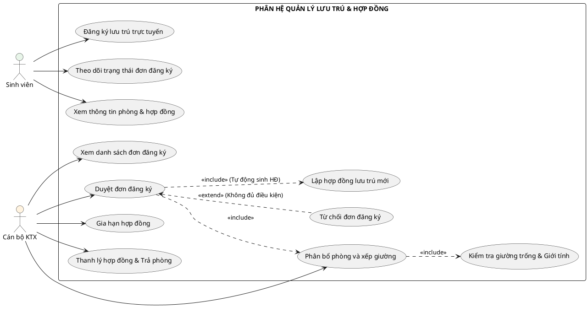
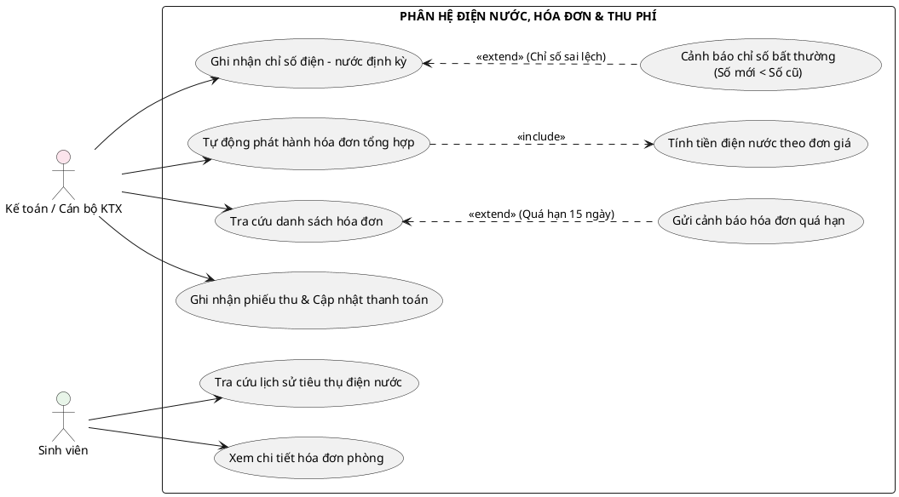
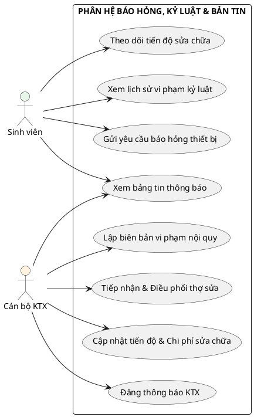
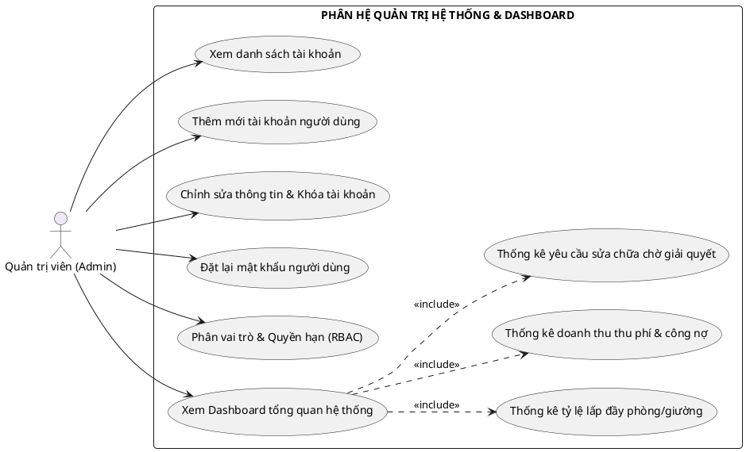
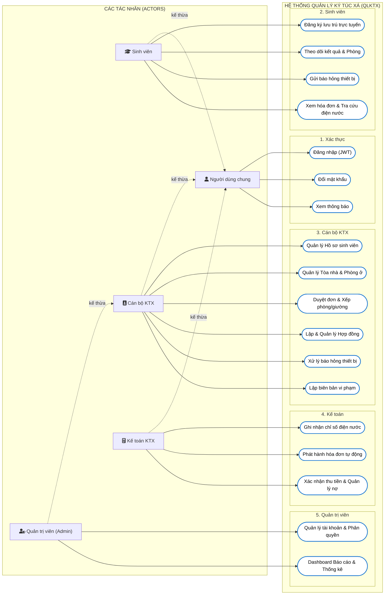

# TÀI LIỆU THIẾT KẾ USE CASE DIAGRAM (SƠ ĐỒ TRƯỜNG HỢP SỬ DỤNG)
## DỰ ÁN: HỆ THỐNG QUẢN LÝ KÝ TÚC XÁ (QLKTX)

---

### LỊCH SỬ CHỈNH SỬA
| Phiên bản | Ngày | Người thực hiện | Ghi chú |
|:---:|:---:|---|---|
| 1.0 | 26/10/2026 | Nhóm 06 (Đỗ Thành Đức, Dương Minh Hùng, Tống Nhật Phát, Vũ Thành Tâm, Phạm Nhật Đăng) | Khởi tạo tài liệu đặc tả Use Case Diagram và mã nguồn vẽ tự động |

---

## PHẦN I. HƯỚNG DẪN DÙNG TOOL TỰ ĐỘNG VẼ (CHỈ 5 GIÂY)

Không cần phải tốn công vẽ tay từng hình elip hay kéo từng mũi tên, bạn có thể dùng các công cụ tự động hóa sau đây bằng cách copy các đoạn mã **PlantUML** hoặc **Mermaid** ở Phần II và dán vào:

### 1. Dùng Draw.io (diagrams.net) - Khuyên dùng nhất cho báo cáo Word
* **Bước 1:** Truy cập website [app.diagrams.net](https://app.diagrams.net/) (hoặc mở ứng dụng Draw.io trên máy tính).
* **Bước 2:** Trên thanh menu trên cùng, bấm chọn: **Arrange** (Sắp xếp) $\rightarrow$ **Insert** (Chèn) $\rightarrow$ **Advanced** (Nâng cao) $\rightarrow$ chọn **PlantUML...**
* **Bước 3:** Copy toàn bộ đoạn mã trong khối `@startuml ... @enduml` ở mục tương ứng bên dưới, dán vào ô nhập liệu rồi nhấn nút **Insert**.
* **Bước 4:** Draw.io sẽ **tự động vẽ thành sơ đồ hoàn chỉnh chuẩn UML quốc tế** với đầy đủ Actor, Use Case, ranh giới hệ thống, mũi tên `<<include>>`, `<<extend>>`.
* **Bước 5:** Bấm **File** $\rightarrow$ **Export as** $\rightarrow$ **PNG** hoặc **SVG** để chèn vào Word hoặc lưu file `.drawio` để nộp cho giảng viên.

### 2. Dùng PlantText (Xem và tải ảnh trực tiếp online)
* Truy cập: [www.planttext.com](https://www.planttext.com/)
* Xóa nội dung mẫu, dán mã PlantUML vào ô bên trái.
* Nhấn nút **Refresh** (hoặc tổ hợp phím `Ctrl + Enter`), ảnh sơ đồ sắc nét sẽ hiển thị ngay bên phải để bạn tải về máy.

### 3. Dùng Mermaid Live Editor
* Truy cập: [mermaid.live](https://mermaid.live/)
* Dán mã Mermaid vào ô code bên trái, tải ảnh SVG/PNG ở góc trên bên phải.

---

## PHẦN II. ĐẶC TẢ TÁC NHÂN (ACTORS) VÀ RANH GIỚI HỆ THỐNG

### 1. Danh sách các Tác nhân (Actors)

| STT | Tác nhân (Actor) | Vai trò & Trách nhiệm |
|:---:|---|---|
| 1 | **Người dùng chung (User)** | Tác nhân cơ sở (Base Actor). Cung cấp các chức năng chung: Đăng nhập hệ thống, Đăng xuất, Đổi mật khẩu cá nhân, Xem thông báo KTX. |
| 2 | **Sinh viên (Student)** | Người dùng nội trú/đăng ký. Nộp đơn đăng ký phòng, theo dõi xét duyệt, xem thông tin phòng/giường, gửi báo hỏng thiết bị, tra cứu điện nước, xem hóa đơn và xem lịch sử vi phạm. |
| 3 | **Cán bộ KTX (Staff)** | Cán bộ nghiệp vụ quản lý sinh viên và cơ sở hạ tầng. Tiếp nhận duyệt đơn đăng ký, xếp phòng/giường, lập hợp đồng lưu trú, bàn giao/thanh lý phòng, tiếp nhận xử lý báo hỏng, lập biên bản vi phạm kỷ luật. |
| 4 | **Kế toán KTX (Accountant)** | Phụ trách tài chính KTX (trong hệ thống thực tế có thể kiêm nhiệm hoặc phân quyền riêng). Ghi nhận chỉ số điện nước hàng tháng, phát hành hóa đơn tổng hợp, thu tiền và theo dõi công nợ quá hạn. |
| 5 | **Quản trị viên (Admin)** | Quản trị hệ thống cấp cao nhất. Toàn quyền quản lý tài khoản người dùng, phân quyền vai trò (RBAC), quản lý danh mục tòa nhà/phòng/giá, và theo dõi Dashboard thống kê tổng quan. *(Admin kế thừa toàn bộ quyền của Staff)*. |

### 2. Quan hệ kế thừa giữa các Tác nhân (Actor Generalization)
* `Admin` $\longrightarrow$ Kế thừa (Inherits) $\longrightarrow$ `Cán bộ KTX (Staff)`
* `Admin`, `Cán bộ KTX`, `Kế toán KTX`, `Sinh viên` $\longrightarrow$ Kế thừa $\longrightarrow$ `Người dùng (User)`

---

## PHẦN III. SƠ ĐỒ USE CASE TỔNG QUAN HỆ THỐNG (OVERALL USE CASE DIAGRAM)

### Mã PlantUML (Dán vào Draw.io hoặc PlantText)

```plantuml
@startuml
left to right direction
skinparam packageStyle rectangle
skinparam roundcorner 12
skinparam shadowing true
skinparam actorStyle awesome

skinparam actor {
    BackgroundColor #E1F5FE
    BorderColor #0288D1
}

skinparam usecase {
    BackgroundColor #FFFFFF
    BorderColor #1976D2
    ArrowColor #37474F
}

actor "Người dùng chung\n(User)" as User
actor "Sinh viên\n(Student)" as Student
actor "Cán bộ KTX\n(Staff)" as Staff
actor "Kế toán KTX\n(Accountant)" as Accountant
actor "Quản trị viên\n(Admin)" as Admin

' Quan hệ kế thừa Actor
User <|-- Student
User <|-- Staff
User <|-- Accountant
Staff <|-- Admin

rectangle "HỆ THỐNG QUẢN LÝ KÝ TÚC XÁ (QLKTX)" as SystemBoundary {

    ' Phân hệ Xác thực
    package "1. Xác thực & Tài khoản chung" #F5F5F5 {
        usecase "UC01. Đăng nhập hệ thống (JWT)" as UC_Login
        usecase "UC02. Đăng xuất" as UC_Logout
        usecase "UC03. Đổi mật khẩu cá nhân" as UC_ChangePass
        usecase "UC04. Xem thông báo KTX" as UC_ViewNotice
    }

    ' Phân hệ Sinh viên
    package "2. Phân hệ Sinh viên (Self-Service)" #E8F5E9 {
        usecase "UC05. Nộp đơn đăng ký phòng" as UC_RegisterRoom
        usecase "UC06. Theo dõi kết quả xét duyệt" as UC_TrackApp
        usecase "UC07. Xem thông tin phòng & giường" as UC_ViewMyRoom
        usecase "UC08. Gửi yêu cầu báo hỏng thiết bị" as UC_ReportRepair
        usecase "UC09. Tra cứu chỉ số điện - nước" as UC_ViewUtility
        usecase "UC10. Xem chi tiết hóa đơn & nộp tiền" as UC_ViewInvoice
        usecase "UC11. Xem lịch sử vi phạm nội quy" as UC_ViewViolation
    }

    ' Phân hệ Cán bộ KTX
    package "3. Phân hệ Cán bộ Quản lý KTX" #FFF3E0 {
        usecase "UC12. Quản lý hồ sơ sinh viên" as UC_ManageStudent
        usecase "UC13. Quản lý Tòa nhà & Phòng ở" as UC_ManageFacility
        usecase "UC14. Xét duyệt đơn đăng ký & Xếp giường" as UC_ApproveRoom
        usecase "UC15. Lập & Quản lý Hợp đồng lưu trú" as UC_ManageContract
        usecase "UC16. Tiếp nhận & Điều phối sửa chữa" as UC_HandleRepair
        usecase "UC17. Lập biên bản xử lý kỷ luật" as UC_ManageViolation
        usecase "UC18. Đăng thông báo mới" as UC_PostNotice
    }

    ' Phân hệ Kế toán
    package "4. Phân hệ Điện nước & Tài chính" #FCE4EC {
        usecase "UC19. Ghi nhận chỉ số điện - nước" as UC_RecordUtility
        usecase "UC20. Tự động phát hành hóa đơn" as UC_GenerateInvoice
        usecase "UC21. Xác nhận thanh toán & Phiếu thu" as UC_ConfirmPayment
        usecase "UC22. Theo dõi công nợ quá hạn" as UC_TrackDebt
    }

    ' Phân hệ Admin
    package "5. Phân hệ Quản trị Hệ thống" #EDE7F6 {
        usecase "UC23. Quản lý tài khoản người dùng" as UC_ManageUser
        usecase "UC24. Phân quyền vai trò (RBAC)" as UC_RolePerm
        usecase "UC25. Xem Dashboard báo cáo & thống kê" as UC_ViewDashboard
    }
}

' Liên kết User chung
User --> UC_Login
User --> UC_Logout
User --> UC_ChangePass
User --> UC_ViewNotice

' Liên kết Sinh viên
Student --> UC_RegisterRoom
Student --> UC_TrackApp
Student --> UC_ViewMyRoom
Student --> UC_ReportRepair
Student --> UC_ViewUtility
Student --> UC_ViewInvoice
Student --> UC_ViewViolation

' Liên kết Cán bộ KTX
Staff --> UC_ManageStudent
Staff --> UC_ManageFacility
Staff --> UC_ApproveRoom
Staff --> UC_ManageContract
Staff --> UC_HandleRepair
Staff --> UC_ManageViolation
Staff --> UC_PostNotice

' Liên kết Kế toán
Accountant --> UC_RecordUtility
Accountant --> UC_GenerateInvoice
Accountant --> UC_ConfirmPayment
Accountant --> UC_TrackDebt

' Liên kết Admin
Admin --> UC_ManageUser
Admin --> UC_RolePerm
Admin --> UC_ViewDashboard

@enduml
```

---

## PHẦN IV. SƠ ĐỒ USE CASE CHI TIẾT THEO TỪNG PHÂN HỆ NGHIỆP VỤ

### 1. Phân hệ Lưu trú: Đăng ký, Xét duyệt, Xếp phòng & Hợp đồng (Module 01)

Sơ đồ này làm rõ các quan hệ ràng buộc nghiệp vụ quan trọng:
* **`<<include>>`**: Khi Cán bộ thực hiện "Xếp phòng & giường", hệ thống **bắt buộc** phải thực hiện "Kiểm tra giường trống & Phù hợp giới tính".
* **`<<include>>`**: Khi Duyệt đơn thành công, hệ thống **bắt buộc** tự động "Khởi tạo Hợp đồng lưu trú".
* **`<<extend>>`**: Khi Đơn không đủ điều kiện, mở rộng sang "Từ chối đơn kèm lý do".

#### Mã PlantUML:

---

### 2. Phân hệ Điện - Nước & Hóa đơn - Thu phí (Module 02)

Sơ đồ làm rõ:
* **`<<extend>>`**: Ghi nhận chỉ số điện nước nếu số mới < số cũ sẽ mở rộng sang trường hợp "Cảnh báo chỉ số bất thường".
* **`<<include>>`**: Tự động phát hành hóa đơn bắt buộc phải "Tính tiền điện nước theo biểu giá".
* **`<<extend>>`**: Quản lý hóa đơn nếu quá hạn thanh toán sẽ mở rộng sang "Gửi thông báo nhắc nợ".

#### Mã PlantUML:

---

### 3. Phân hệ Báo hỏng, Kỷ luật & Bản tin (Module 03)

#### Mã PlantUML:

---

### 4. Phân hệ Quản trị Hệ thống, Tài khoản & Báo cáo Dashboard (Module 04)

#### Mã PlantUML:

---

## PHẦN V. MÃ MERMAID DIAGRAM (HIỂN THỊ TRỰC TIẾP TRÊN GITHUB / VS CODE / MARKDOWN)

Nếu bạn muốn nhúng trực tiếp vào file Markdown để xem ngay mà không cần cài extension PlantUML, có thể dùng cú pháp Mermaid dưới đây:

---

## PHẦN VI. BẢNG MA TRẬN ĐỐI CHIẾU USE CASE VỚI YÊU CẦU CHỨC NĂNG (TRACEABILITY)

| Mã Use Case | Tên Use Case | Tác nhân chính | Yêu cầu chức năng tương ứng (Architecture Driver) |
|---|---|---|:---:|
| **UC01 - UC03** | Đăng nhập, Đăng xuất, Đổi mật khẩu | Tất cả người dùng | **FR01** |
| **UC23 - UC24** | Quản lý tài khoản, Phân quyền RBAC | Admin | **FR02** |
| **UC13** | Quản lý Tòa nhà, Phòng ở, Giường trống | Cán bộ KTX, Admin | **FR03** |
| **UC07, UC12** | Quản lý hồ sơ sinh viên, Tra cứu sinh viên | Cán bộ KTX, Sinh viên | **FR04** |
| **UC05, UC06, UC10** | Đăng ký phòng, Duyệt đơn, Xếp giường | Sinh viên, Cán bộ KTX | **FR05** |
| **UC11** | Lập hợp đồng, Gia hạn, Thanh lý hợp đồng | Cán bộ KTX, Sinh viên | **FR06** |
| **UC09, UC14** | Ghi nhận điện nước, Cảnh báo chỉ số sai | Kế toán KTX, Sinh viên | **FR07** |
| **UC10, UC15, UC16** | Phát hành hóa đơn, Thu tiền, Theo dõi nợ | Kế toán KTX, Sinh viên | **FR08** |
| **UC06, UC12** | Gửi báo hỏng, Điều phối thợ sửa chữa | Sinh viên, Cán bộ KTX | **FR09** |
| **UC11, UC13** | Lập biên bản vi phạm, Xem kỷ luật | Cán bộ KTX, Sinh viên | **FR10** |
| **UC04, UC18** | Đăng và xem thông tin bản tin KTX | Cán bộ KTX, Sinh viên | **FR11** |
| **UC18, UC25** | Dashboard thống kê doanh thu, tỷ lệ phòng | Admin, Cán bộ KTX | **FR12** |

---
*Tài liệu được thiết kế chuyên biệt và tối ưu hóa 100% cho dự án Quản lý Ký túc xá (QLKTX) của Nhóm 06.*
